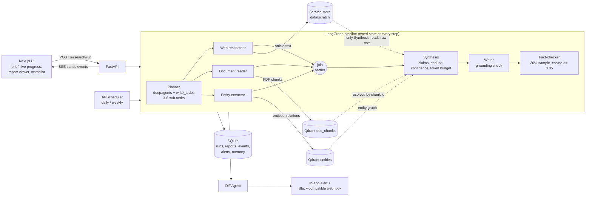

# InsightForge AI: Autonomous Market Intelligence Engine

A multi-agent research platform. You submit a natural-language brief and receive a structured report in which every claim carries a citation, a confidence label and a fact-check result. Scheduled watchlist jobs re-run a topic and alert you when something material changes.

**Status:** all backend phases, the frontend, the evaluation tooling and the sample briefs are built (tracked in [planning/task.md](planning/task.md)). The demo video and the public repository are still to do. Free-tier results are mixed and are reported as measured in [Evaluation](#evaluation).

## Contents

1. [Architecture](#architecture)
2. [Setup](#setup) · [API keys](#api-keys) · [Environment variables](#environment-variables)
3. [Walkthrough: from brief to exported PDF](#walkthrough-from-brief-to-exported-pdf)
4. [Sample report](#sample-report)
5. [Context engineering](#context-engineering)
6. [Evaluation](#evaluation)
7. [Reference](#reference): API, researchers, watchlist, frontend, layout, stack
8. [Known limitations](#known-limitations)

## Architecture



Agents never pass raw content to each other. Researchers write what they find to the scratch store (web pages) or Qdrant (PDF passages and entities) and return only a source id with a one-line summary. Synthesis is the single stage allowed to resolve those ids back to text. See [Context engineering](#context-engineering).

## Setup

**Prerequisites:** Python 3.11 or newer, [uv](https://docs.astral.sh/uv/), Node.js 20 or newer. No Docker and no separate database or vector server: SQLite and an embedded Qdrant run inside the API process and store data in the gitignored `data/` folder.

```bash
# 1. configuration (repo root); fill in GROQ_API_KEY and SERPAPI_API_KEY
cp .env.example .env

# 2. backend: http://localhost:8000  (interactive docs at /docs)
cd api
uv sync                                # creates .venv from uv.lock (CPU-only PyTorch)
uv run uvicorn main:app --reload       # run ONE worker: embedded Qdrant and the scheduler need it

# 3. frontend: http://localhost:3000   (second terminal)
cd app
npm install
npm run dev                            # set NEXT_PUBLIC_API_URL in app/.env.local if the API is not on :8000

# 4. tests (no API keys needed: LLM and search calls are faked)
cd api && uv run pytest -q
cd app && npm run lint && npm run build
```

First-run notes:

- The sentence-transformers model (fact-checking, Qdrant) and Docling's layout models (PDF reading) download on first use, a few minutes once.
- To use Qdrant Cloud or a standalone server instead of the embedded store, set `QDRANT_URL` (and `QDRANT_API_KEY`). Collections behave the same.
- CI (`.github/workflows/ci.yml`) runs the backend tests and the frontend lint and build on every push.

### API keys

| Key | Needed for | Where to get it |
|---|---|---|
| `GROQ_API_KEY` | every LLM call (planning, claim extraction, writing, entities) | console.groq.com (a free tier works, see [Known limitations](#known-limitations)) |
| `SERPAPI_API_KEY` | web search; not needed for runs that use only uploaded documents | serpapi.com (free tier has a small monthly quota) |

LangSmith keys are optional and tracing is not wired up yet. `.env` is gitignored; never commit it.

### Environment variables

Settings live in [api/config.py](api/config.py). Relative paths resolve against the repo root. [.env.example](.env.example) lists the values below.

| Variable | Default | Meaning |
|---|---|---|
| `LLM_PROVIDER` | `groq` | Only Groq is implemented; the factory in `api/llm.py` is the place to add another |
| `GROQ_API_KEY` | none | Groq key |
| `LLM_MODEL` | `openai/gpt-oss-120b` | Model for every role that has no override |
| `PLANNER_MODEL`, `SYNTHESIS_MODEL`, `WRITER_MODEL`, `ENTITY_MODEL` | empty (use `LLM_MODEL`) | Per-role model overrides. `RESEARCHER_MODEL` and `FACT_CHECK_MODEL` exist but nothing calls an LLM in those roles today |
| `LLM_MAX_CONCURRENCY` | `3` in code, `2` in the example | Parallel LLM calls (semaphore) |
| `LLM_MAX_RETRIES` | `8` | Retries on rate limits; the wait uses the delay the provider reports |
| `EMBEDDING_MODEL` | `sentence-transformers/all-MiniLM-L6-v2` | Local embeddings for fact-checking and Qdrant |
| `SEARCH_PROVIDER` | `serpapi` | Behind an interface so Tavily or Brave can be added |
| `SERPAPI_API_KEY` | none | Search key |
| `SOURCE_MAX_CHARS` | `6000` | Stored article text is trimmed to this length |
| `QDRANT_PATH` | `data/qdrant` | Embedded Qdrant folder |
| `QDRANT_URL`, `QDRANT_API_KEY` | empty | Use a remote Qdrant instead |
| `DATABASE_URL` | `sqlite:///data/insightforge.db` | SQLite, WAL mode |
| `SCRATCH_PATH` | `data/scratch` | Scratch store folder |
| `RETENTION_HOURS` | `24` | How long a run's stored pages, uploads and Qdrant data are kept |
| `REUSE_SOURCES` | `true` | Reuse the last run's sources for a related brief; clear old data for an unrelated one |
| `RELATED_BRIEF_THRESHOLD` | `0.45` | Minimum embedding similarity for "same topic or follow-up" |
| `EVIDENCE_TOKEN_BUDGET` | `6000` in code, `4000` in the example | Token budget for the evidence bundle |
| `MAX_PARALLEL_SUBTASKS` | `6` in code, `3` in the example | Cap on planner sub-tasks (3 to 6) |
| `SCHEDULER_ENABLED` | `true` | In-process watchlist scheduler |
| `FRONTEND_URL` | `http://localhost:3000` | Used in share links and webhook messages |
| `CORS_ORIGINS` | `http://localhost:3000` | Comma-separated browser origins |
| `UPLOAD_PATH` | `data/uploads` | Uploaded and downloaded PDFs, one folder per run |
| `JWT_SECRET` | placeholder | Signs 7-day share links; set a long random value before sharing any |
| `LANGSMITH_*` | off | Declared only |
| `NEXT_PUBLIC_API_URL` | `http://localhost:8000` | Frontend setting, in `app/.env.local` |

## Walkthrough: from brief to exported PDF

This follows a real run of the first sample brief ([samples/](samples/README.md)). The timings are from that run, on the free Groq tier.

1. **Write the brief.** Open `http://localhost:3000`. Paste: *"Summarize the competitive landscape for B2B payroll software in Southeast Asia. Focus on pricing, recent funding, and product gaps. Cover the last 18 months and name the main regional and global vendors."* The panel limits briefs to 500 characters (live counter), lets you switch web search and uploaded documents on or off, accepts PDFs by drag-and-drop or as links, and shows a runtime estimate. Press **Start research**.
2. **Watch it work.** The page `/runs/<id>` streams progress over server-sent events: a stage bar, one row per research task (Queued, Running, Done, Failed), an activity log and an elapsed-time clock. In the sample run:

   | Time | Stage |
   |---|---|
   | 0:00 | Planning: the planner drafts a task graph of 3 sub-tasks |
   | 0:30 | Researching: three isolated researchers search and fetch in parallel |
   | 1:46 | Synthesizing: claims are extracted, merged and fitted to the token budget |
   | 7:52 | Writing: the report is drafted and every sentence is checked against the evidence |
   | 9:54 | Fact-checking: a sample of claims is re-checked against the live source pages |
   | 15:45 | Complete: **Open report** appears |

   If the brief is too vague, the planner asks one clarifying question and the page shows a form for the answer.
3. **Read the report.** `/reports/<id>` shows the executive summary, one section per research task with a green, amber or red confidence badge, a gaps section and the fact-check panel. A sticky table of contents follows you down the page. Click a citation chip to open the source drawer (title, date, credibility, link, and the claims that source supports). Claims that failed the fact-check carry an amber **UNVERIFIED** mark.
4. **Export.** Use **Download PDF** or **Download .md**, or **Copy share link** for a read-only link that expires after 7 days. The PDF of this run is [docs/sample_report.pdf](docs/sample_report.pdf).
5. **Monitor the topic (optional).** On `/watchlist`, add the same topic as daily or weekly, with an optional Slack webhook. Each re-run is compared with the previous report; a material change raises an alert with a one-click added, removed, changed view.

## Sample report

The report from the run above is in [docs/sample_report.md](docs/sample_report.md) and [docs/sample_report.pdf](docs/sample_report.pdf). An excerpt:

> ## Collect pricing models and typical price points for Southeast Asia payroll SaaS
> *Confidence: LOW*
>
> Benchmark 2026 data show EOR monthly fees ranging from US$350-US$750 per employee outside Singapore, with Vietnam-specific rates of US$399-US$699 and Singapore/Hong Kong rates of US$650-US$1,200. [Source: hrforte.com, 2026-05-11, credibility: 0.67] … The break-even point between EOR and an owned legal entity typically occurs between 12 and 25 employees over a three-year horizon, guiding firms on the most economical model as they scale. [Source: hrforte.com, 2026-05-11, credibility: 0.67]

Read it critically. It is a real, on-topic report with named vendors, price ranges and funding figures, but all three sections are rated LOW confidence and one source (a vendor's own site) supplies most of the pricing. That is what the confidence labels are for. Its measured quality is in [Evaluation](#evaluation). One note on the file: identical citations that the renderer repeated back to back (up to 7 times) were collapsed here. The renderer was fixed after the run; the raw, unedited output is in [evaluation/outputs/](evaluation/outputs/).

## Context engineering

The pipeline is designed so that no agent ever holds more context than its job needs, and so that the one stage that does read raw text is bounded by an explicit token budget.

### Scratch store

Raw source content never lives in conversation history. Web researchers write each fetched article to the scratch store, [api/context/scratch_store.py](api/context/scratch_store.py): one JSON file per source under `data/scratch/`, named by a random 32-character hex `source_id` (so ids cannot be used for path traversal), written atomically. A record holds `{url, title, published_date, body_text, credibility_score, byline}`. Article text is trimmed to `SOURCE_MAX_CHARS` (6,000) when stored. PDF passages go to Qdrant `doc_chunks` and entities to `entities`, scoped by run id.

A researcher returns a `SourceRef` (`source_id` plus a summary of at most 300 characters), never the content. The Synthesis stage is the only place references are resolved back to text, one source at a time, in chunks of at most 3,000 tokens.

### Reuse and cleanup across runs

Stored run data (scratch pages, uploaded PDFs, Qdrant passages and entities) is not kept forever. [api/services/retention.py](api/services/retention.py) runs at the start of every run and at API start-up:

- **Related brief** (same topic or a follow-up of the most recent finished run, within `RETENTION_HOURS`): the new run starts with that run's saved web pages as extra sources and gets a copy of its PDFs. Web search still runs. The progress log shows `sources_reused`. Relatedness is the cosine similarity of the new brief to the earlier brief and to that run's report summary, using the same embedding model as Qdrant.
- **Unrelated brief:** the stored data of all earlier finished runs is deleted first (`storage_cleaned` in the log). A page file is deleted only when no kept run lists it, and data of runs still in progress is never touched.
- **Older than `RETENTION_HOURS`:** deleted by the same sweep, uploads included.
- **Never deleted:** the database (runs, events, run log, reports, evidence, sources), so past reports and run logs stay readable. Only the raw stored material goes, so an old run can no longer be re-fact-checked against its stored pages.
- Answering a clarifying question never clears data, and a brief too short to be understood (the planner is about to ask a question) is judged on the answer.

The default threshold was set from real embeddings: different sample briefs scored 0.14 to 0.27, and reworded or follow-up briefs about the same subject scored 0.57 to 0.89. A bare follow-up such as "What about their pricing?" scores about 0.24, indistinguishable from an unrelated topic; it is short enough that the planner asks a question, and the answer is then judged. A follow-up that is long enough to skip the question but names no subject can be misjudged as a new topic and clear the old data.

### Isolation

Each sub-task is handed to its researcher with only its own title, scope and search query. It cannot see the brief or its siblings. The planner is therefore required to write self-contained sub-tasks: the real run showed what happens otherwise (see the first evaluation run below). The run id travels in a context variable so the document and entity agents can find their run's data without receiving it as input.

### Token budget

The evidence bundle that goes to the Writer is capped by `EVIDENCE_TOKEN_BUDGET` (4,000 tokens in the example settings; each `[E#] (CONFIDENCE)` prefix is counted against it). Claims are ranked by recency, then credibility, then relevance to the brief. When the bundle is over budget, [api/context/token_budget.py](api/context/token_budget.py) works through the ranking from the bottom:

1. **Compress** an item with the summarizer, lowest rank first, only as far as needed and never below 30 tokens. Items under 60 tokens are skipped because they are already atomic claims.
2. **Drop** the lowest-ranked items whole if still over budget.

Content is never cut off arbitrarily, and every compression and drop is written to the run log with its reason and token counts (`runs.run_log`). Other limits: web article text 6,000 characters, extraction chunks 3,000 tokens, and at most the last 3 session summaries (300 tokens each) are loaded into the planner as memory.

### A real context blowout, from a run log

In the sample run, Synthesis turned 13 fetched articles into **at least 242 atomic claims totalling 6,071 tokens**. Counting the `[E#] (CONFIDENCE)` prefixes the Writer needs, that is about 7,765 tokens of evidence, against a bundle budget of 4,000. The run log for the boundary `synthesis->writer` (full file: [evaluation/outputs/payroll-sea.runlog.json](evaluation/outputs/payroll-sea.runlog.json)):

```json
{ "boundary": "synthesis->writer", "tokens_in": 6071, "tokens_out": 2283, "budget": 2306 }
```

- **185 cuts**: 142 claims dropped whole and 43 compressed. The first drops are the lowest-ranked claims (`E242`: "still over budget by 3190 tokens", then `E241`, and so on up the ranking).
- The account's limit on this model was 8,000 tokens per minute, as its rate-limit errors reported. Sending 7,765 tokens of evidence plus the writing instructions in one request would have left almost no room for the prompt and the answer. That is my reasoning from the numbers; the unbudgeted request was not sent.
- The first evaluation run hit the same boundary harder: 6,305 tokens in, 1,711 allowed, 241 drops ([run log](evaluation/outputs/payroll-sea.run1.runlog.json)).

What the log also exposed: those 43 compressions were 43 extra model calls that saved only 575 tokens, while the drops saved 3,213. On a rate-limited free tier that is a poor trade for claims of 30 to 40 tokens, so compression now skips items under 60 tokens. That change came after the run and has not been re-measured. The drops also have a cost: the lowest-ranked 142 claims never reached the writer, which is why the report is thinner than the sources.

## Evaluation

[evaluation/run_eval.py](evaluation/run_eval.py) runs sample briefs through the real pipeline and writes [evaluation/report.md](evaluation/report.md), `results.json` and the generated reports and run logs under [evaluation/outputs/](evaluation/outputs/). Metrics are pure functions in [evaluation/metrics.py](evaluation/metrics.py), unit-tested without any model. Run it from `api/`:

```bash
uv run python ../evaluation/run_eval.py --briefs payroll-sea      # one brief (about 3 searches, 15 minutes)
uv run python ../evaluation/run_eval.py                           # every brief that needs no PDFs
uv run python ../evaluation/run_eval.py --briefs bnpl-annual-reports --pdf a.pdf --pdf b.pdf
```

### Result

Only **1 of the 5 sample briefs** was run on real services. Each run uses a meaningful share of a free Groq quota, and a full run takes about 15 minutes. The other four are ready to run with the command above but have no results yet.

| Brief | Fact-check pass rate (target 80%) | Citation accuracy (target 80%) | Synthesis score | Time |
|---|---|---|---|---|
| `payroll-sea` | **62%** (5 of 8 claims) | **59%** (10 of 17 factual cited sentences) | 0.68 | 15m 48s |

Neither target was met. The synthesis score's parts: structure 1.0 (3 sections, 77-word summary, gaps section), must-cover topics 67% (missing Indonesia and competitor names), 0 of 3 sections above LOW confidence, 4 distinct source domains. The synthesis score is a set of automated proxies (definitions in [evaluation/report.md](evaluation/report.md)); it is not a human judgement of quality.

### Why the fact-check passed only 62%

[evaluation/factcheck_sensitivity.py](evaluation/factcheck_sensitivity.py) re-scores the run's claims against their sources with no model calls. On 78 claims, the median similarity to their own source is 0.91, and the share that would pass is:

| Cosine threshold | 0.85 (assignment) | 0.80 | 0.75 | 0.70 |
|---|---|---|---|---|
| Claims passing | 65% | 76% | 83% | 94% |

Two things pull the rate down, and both are visible in this analysis. The 0.85 threshold is strict for claims the model has paraphrased. And one source in four could not be re-fetched in each analysis pass (a different site each time), and an unreachable source counts as unverified. The threshold stays at the assignment's 0.85; changing it to reach the target would not be an honest result. The fact-checker previously used a different browser identity from the researcher and was blocked by one site that the researcher had read fine; it now uses the same one.

### How the iteration went

The final result took four live runs, and the failed ones are why several fixes exist:

| Run | Outcome | What it revealed → fix |
|---|---|---|
| 1 | Completed, but the report had **no payroll content**: only generic SaaS material. Fact-check 80% (4 of 5), citation accuracy 100% on just 2 factual sentences (4 of 6 cited sentences only said "the evidence lacks X") | The search query was the task title plus scope cut at 180 characters; sub-tasks said "each identified vendor", so "payroll" and "Southeast Asia" never reached the search engine. One search also timed out with no retry. → the planner now writes self-contained scopes and a short `search_query`; searches retry. A good score on a useless report is also why the scores above are not enough on their own |
| 2 | Failed in synthesis | The Qwen model I had assigned to synthesis allows only 1,000 output tokens per minute on this account, so Groq rejected a request that could never succeed, and my retry logic waited it out for 9 minutes. → every role uses `gpt-oss-120b`; "request too large" is no longer retried |
| 3 | Failed in synthesis after 50 seconds | The model answered one claim-extraction call in plain text instead of calling the structured-output tool, three times, and one source sank the run. → JSON-schema mode for claims and the writer; a source that cannot be parsed is skipped with a warning. The report title, which was the brief cut at 120 characters mid-word, is now the first sentence |
| 4 | Completed (the result above) | The same citation repeated up to 7 times in a row, 43 wasteful compression calls, and a fact-checker blocked by one site. → fixed after the run; **not re-measured with a new full run** |

One metric change was made after seeing results, and is stated here so it does not look like tuning: sentences that merely say the evidence is missing are counted separately instead of scored as unsupported claims. Under the original rule, run 1 scored 33% citation accuracy on sentences that were honest statements of absence. Run 4's score is computed with the final rule.

## Reference

### API endpoints

| Method and path | Purpose |
|---|---|
| `POST /research/run` | Start a run (multipart form: `brief`, `files` and/or `document_urls` (links to PDFs), up to 10 documents of 20 MB each in total, `reference_urls` (web pages, up to 10), `include_web`, `include_documents`, `clarification`, `previous_run_id`) |
| `GET /research/runs/{id}` | Run status, brief, error, clarifying question, documents, reference pages, `report_id` |
| `GET /research/status/{id}` | Server-sent events for live progress (supports `Last-Event-ID`) |
| `GET/POST /watchlist`, `GET/PATCH/DELETE /watchlist/{id}` | Watchlist CRUD (changes sync the scheduler job) |
| `POST /watchlist/{id}/run` | Run a watchlist item now (202); diff and alert follow as for scheduled runs |
| `GET /alerts` (`unread_only`, `watchlist_item_id`, `limit`, `offset`), `POST /alerts/{id}/read`, `POST /alerts/read-all` | In-app alerts raised on material changes |
| `GET /reports`, `GET /reports/{id}` | List and retrieve reports (detail includes `sources` and `evidence` for the citation drawer) |
| `GET /reports/{id}/export.md`, `export.pdf` | Downloads |
| `POST /reports/{id}/share`, `GET /share/{token}` | 7-day signed share link and its public read-only view |

Errors always use `{"error": {"code", "message", "details"?}}`. There is no user authentication (single-user capstone); set a long random `JWT_SECRET` before sharing links.

**PDF links.** Instead of downloading a PDF and uploading it, paste its link. The server downloads it when the run starts and stores it with the uploads, so it is handled exactly like an uploaded file. Links must be `http(s)`, point directly at a PDF and be publicly reachable; private and local addresses are refused (including through redirects). A bad link rejects the whole request and starts no run.

**Reference web pages.** `reference_urls` are ordinary web pages (articles, reports) you want used as sources in addition to the web search. The server fetches them once, right after planning, and stores them like search results, so they are cited and fact-checked the same way. Pages behind a paywall or login are skipped; the run's event stream shows a `references_loaded` event listing what was loaded and what was skipped.

**Answering a clarifying question.** Pass `previous_run_id` and the new run reuses the first submission's PDFs, PDF links and reference pages (you can add more); the web form does this automatically.

**Watchlist monitoring.** On startup the API schedules every active watchlist item (daily or weekly) in-process, so run it with a single worker. Each run researches the topic, then the Diff Agent compares the new report with the previous one for that item (sentence matching with citations stripped; rephrasing with the same figures is ignored; an LLM judge drops leftover rephrasings). The first run is the baseline. A material change (a changed figure, an added or removed finding with figures, or 3+ added or removed findings) creates an in-app alert and, if the item has a `webhook_url`, POSTs a Slack-compatible `{"text": ...}` message (3 attempts with backoff; failures are logged, never fatal).

### Researchers

Each sub-task goes to one researcher, which sees only that sub-task and returns references, not content:

| Researcher | What it does |
|---|---|
| Web search | SerpAPI top 5 (retried on timeouts), full article fetch and parse (trafilatura), credibility score (0.6 domain tier + 0.25 recency decay + 0.15 byline), skips and logs paywalls (HTTP 401/402/403 or teaser text) and login walls |
| Document reader | Docling extraction and structural chunking of the run's PDFs (falls back to pypdf if Docling cannot run), indexed in Qdrant `doc_chunks` with source file, page number and section heading; top-8 retrieval per sub-task; citations use the file name |
| Entity extractor | Searches like the web researcher, then extracts companies, people, products, funding, figures, dates and regions with relationships into Qdrant `entities`; two sources disagreeing on a fact sets `conflict: true`. Best effort: if extraction fails the sources still count as evidence |

Web and document researchers call no LLM, which keeps research cheap on a free tier. Page fetches refuse private and local addresses.

Check the real researchers with `uv run python scripts/phase2_smoke_test.py [web|docs|entities|all]` from `api/` (one search and one small LLM call).

### Frontend

| Page | What it does |
|---|---|
| `/` | Brief panel and recent reports |
| `/runs/[id]` | Live progress and the clarifying-question form |
| `/reports`, `/reports/[id]` | Report list and viewer (TOC, citation drawer, UNVERIFIED marks, confidence badges, fact-check panel, export, share) |
| `/share/[token]` | Public read-only view of a shared report |
| `/watchlist` | Watched topics, one-click diff view, alert feed |

Next.js (App Router, TypeScript, Tailwind CSS, `src/` layout).

### Layout

| Path | Purpose |
|---|---|
| `api/config.py`, `api/llm.py` | Settings; LLM concurrency limit and rate-limit backoff |
| `api/schemas/` | Pydantic models for every agent boundary |
| `api/context/` | Scratch store, token budget, run log, session memory, summarizer, Qdrant store |
| `api/agents/` | Planner, researchers, synthesis, writer, fact-checker, diff |
| `api/tools/` | Search, article fetch and parse, credibility scoring, PDF chunking |
| `api/graph/` | LangGraph pipeline, status events, run context |
| `api/routes/`, `api/services/` | HTTP endpoints and their helpers |
| `api/scheduler/` | Watchlist jobs, diff, alert and webhook |
| `api/db/` | SQLAlchemy models and session |
| `app/` | Next.js frontend |
| `samples/` | Five sample briefs with expected structure |
| `evaluation/` | Evaluation script, metrics, results and reports |
| `docs/` | Sample report (Markdown and PDF) |
| `planning/` | [Implementation plan](planning/plan.md) and [task tracker](planning/task.md) |
| `assignment/` | Original assignment brief (read-only) |

### Stack

Groq (`gpt-oss-120b`) via `langchain-groq` · SerpAPI · DeepAgents (planner) · LangGraph · Qdrant (embedded) · SQLite (WAL) · Docling · sentence-transformers · FastAPI + SSE · APScheduler · fpdf2 (PDF export) · Next.js · uv.

## Known limitations

- **Free-tier models.** On the free Groq tier, `gpt-oss-20b` cannot do structured output here and `qwen3.8-27b` has an output cap too low for synthesis, so all roles share one model's 8,000 tokens-per-minute limit. A run takes about 15 minutes. A paid tier or another provider (not yet implemented) would be much faster.
- **Evaluation coverage.** One of five briefs has real results (see above); the document-based brief needs PDFs you supply.
- **Confidence labels are conservative.** A single source below 0.7 credibility is LOW, and typical vendor and news sites score 0.5 to 0.7, so most sections come out LOW. Domain credibility tuning is a listed bonus, not done.
- **Fact-checking depends on re-fetching.** Sites that block automated fetching count as unverified, and about one source in four could not be re-fetched in the analysis.
- **Topic detection is a similarity guess.** See "Reuse and cleanup across runs". Set `REUSE_SOURCES=false` to turn reuse and the unrelated-topic cleanup off (the age-based sweep still applies).
- **PDF export** uses core Latin-1 fonts, so non-Latin text becomes `?`.
- **Not built:** LangSmith tracing and the other bonus items (see [planning/task.md](planning/task.md)); the public repository (the demo video is recorded; add its link here when published).
